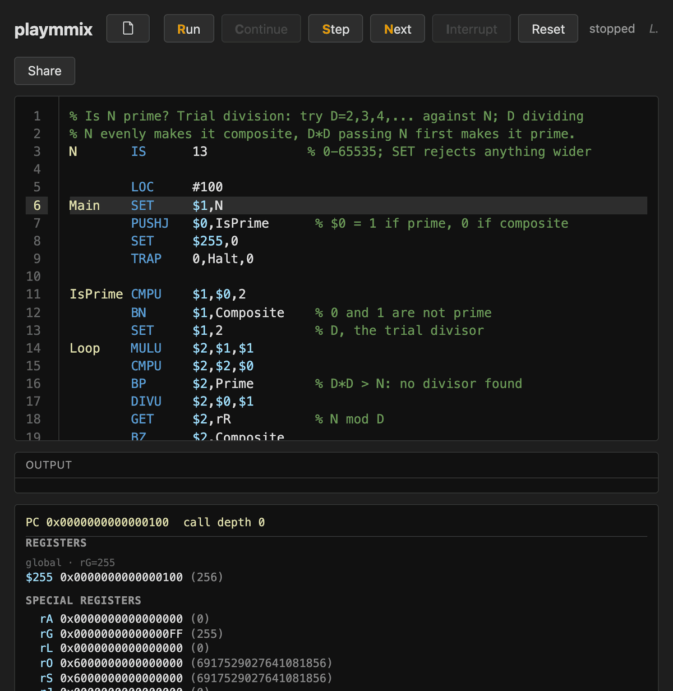
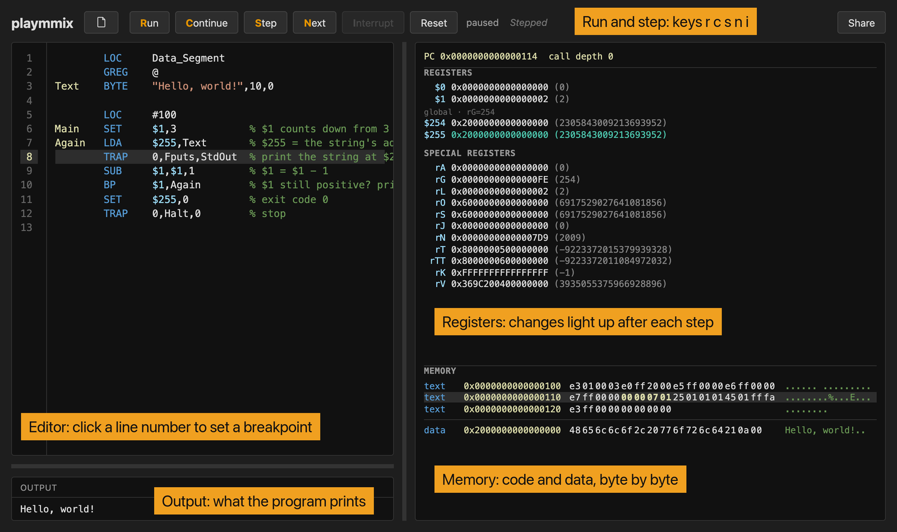

# `playmmix`

<a href="https://playmmix.2ad.com"></a>

Write, run and single-step Knuth's MMIX assembly in your browser, on a
desktop or a phone, with nothing to install.

**[Try it: playmmix.2ad.com](https://playmmix.2ad.com)**

## Examples to try

Click a program's link to open it in `playmmix`, loaded and ready to run.
Hello is short enough to paste in by hand.

### Say hello

Prints a greeting. Change `world` on the `Name` line and run it again.

```asm
% Say hello. Change the name on the next line, then run it.
        LOC     Data_Segment
        GREG    @
Hello   BYTE    "Hello, ",0
Name    BYTE    "world",0
Bang    BYTE    "!",10,0

        LOC     #100
Main    LDA     $255,Hello
        TRAP    0,Fputs,StdOut
        LDA     $255,Name
        TRAP    0,Fputs,StdOut
        LDA     $255,Bang
        TRAP    0,Fputs,StdOut
        SET     $255,0
        TRAP    0,Halt,0
```

**[Open in `playmmix`](https://playmmix.2ad.com/#p=nY7NDoIwEITvPMWKemtMNeEuf8JBxQAXT6YJDZCUYrBEfXvZakCiB2Mvu51vJzNzSNgdCi5EvQC3YDLnoAoOklUcavnc-U2BKCUn-JXQtBJKtTDg9baRq6fHFDslPK-4VD0MYj_AuTZCDOk255j6qJhaIGASauwx7p1d60ZkSJyu0ohMTLKkHfiIny4pNXaslFr0bC3OVpZFdFB_n8b2ASclm3OrLiRRWdQOhUdO7PWXEWv_akz8dDDSL66QCdWBBw)**

```
Hello, world!
```

### On what day will my birthday fall?

Prints the weekday your birthday lands on, year after year. Open it, set
`MONTH`, `DAY`, `FROM` and `YEARS` at the top, and run. The default, 29
February from 2000, prints only the leap years.

**[Open in `playmmix`](https://playmmix.2ad.com/#p=nVjbUttIEH3XV3RloWIqA9HF5pKqrSzE3FKAKQyh2JetwRpjLZLGJY1i_JZ_2D_cL9nuGV0tGWpxSjaa093q6cuZVjZhFMNixhX4fAmLIAwhWsJjkKgZLUx5GH6FbzMePwm4HF3dnjEYHj4wOLkZXQKPfXg4PrwZ71gaA4DzMeiPC83PJjj__vrHcS3U1gul4EGXoOdY-gl1Qdu2VwQH-x7KHuCHgZoJmAZJqmApeGJptxranf7YNoOZXEDE46VWTEFJmCdBrCyrkL0YfdO_Q674X2PxFAlEC_D05viUfv-wLmWsZkO-THPk6OH2GDyHufsMvz279t24tcb8mUdSydu6IiLMZQNGvwPmsD7bxfu-NRbzSgg_H-ADs62rC2isOjYuPuB-hsFToNKG3fKfNc5iSnJlyyyQQdxMEzILBN1mIiWshPIFwu6FHxu09sgP5apWn2VJTSIXKVZJ4iQJms82CwSNucqSlnKxShKtrP2GSbY24UJyXxfJPORBDL1Yxtuh4PMtXfgTmcUKpjIxRQ7TREbAwXG3MdfJEhR_DAVWOamS7eGhtr3h2qxMe_Xk4dGdRh1GAj1tctvZstCN8_REPEJvw92CIAUHW0_E-TPxHrEk48mSgQhTAfZOaXN8bKpjY49p6RL4dnltgH2GmNtWcDEoZbiu_iyEnZMuUcdyzshNKp1D_-8M26m34XX6-p3H5CpgzAq3v0BRyh9TNBIJNZMY9ERwLEH8G7ekFhIiilgKPNX5UDwIQU7139c3xz_OR3dj3Yo7a_botR33Gnu8KoTdky5Rx3L1HitfYS6Sbe0VOjJNRa0SWFEKqZhgB7Qqosp5UREOK_u5XRF9RgK1imj5N2BEfO31Xb3-SfNaR-Y81q_R4yZSMwRRJPyAKwES90dcPZOhn4KMwyXY2-5gYGmKuJBy3hnqAdvY7QorKQxlLEw9o8vQo-RNsiTB2OjcbWHEqLv0zVc4TcSTTAJ0KslC8QX84GeQBhhAeFyikT7W-8tEzBVqTdBElhgyhl5dEEnN3oIsDkWKxROmsjKDNhDHCFQJGZ7_MCE_oI30K74uQoYUmdy0OwOXr6S6QN_XmCI6-R_GztNXbGHe3uOYsVlLv-NgVRca3_MUkoxOU67WELetEsbgDaVI6VzHNATY8kHR5mqGjW5SOKKqKRodW8YwZiR_ipRZm3oU0IUl43rqOwjMcdlG5eyR2R1xz_g5mJNThnfaEuj1GpHD4fCusk0stkawcsJjuN121TvYoIihker511BiZJZaZoU-eEjVrWbRF1gI8UwHyu_QW8InWH7uwzZ-Y9GYO_2r8EKhLeJIJMg9Bkvg2lPha-pBbv2MsWalORsNmsO5K6JYSIN2vDysl4rHK7W74nRCNbwcq1OsLFRnV4v1O5A9Y6DWEBW2r7F6gVdZOjCYs9vhFGF07a3Ro2t_PdZ_M9dtc15ndyK0125O16XmxMRd04yoDy3NVHiY-WISRDwEJV6UoTg_py1IxBzPQOGHeLJPccYO4ic0QcqP2XQqEnPI0KAmsI8e-eR5wRO_I9U4MNZSXR46OEpWw157pwjT1be8s5V9etgwaNPpoDTPq9NQZQu7A6-P9sfKu9ujGubUzuIyrbkHTveOPLdNdzQaH63dSochPM8IKoHbm0PduTY7mWcqZWPljzLVcWCjHg7Vb-lhvjD5NPhQ2oq-DGJfvDBsT-rafJzO5vQOsWuW8sl0B-55-Iw2AnzRkouY6gK5FwSfzEAFkSAgCtIU2RSPOIUjES7EPEJeprLIn7fTwZsu06VoHt6OPOJ0Oes1zWT_Hs188H-PavlK8K7n5i8L79E17xKtw9LEMM-W1RXRZsE0sYaVe5MrfbZ2BbhhaAV73dBqvBuWVsHXTbXj3zDWht_wbDUjTddW0deNraSoYeq19LUMlfnszmEj23Xl91DI1cWbDFJODy1WG-jBsrWrcjq3ypG7k_bs-v9r4AiN41dMo5zCKc0XDGJJk3WqEq5Zp8PRMx4q5O3_AA)**

```
2000 Tuesday
2004 Sunday
2008 Friday
2012 Wednesday
2016 Monday
```

### Digits of pi

A showpiece: an MMIX program that computes `DIGITS` decimal places of pi
with Machin's formula, doing arbitrary-precision arithmetic on arrays held
in memory, each array standing in for one number too wide for any
register. `DIGITS` runs 1–1000. At 343 lines the source lives behind the
link.

**[Open in `playmmix`](https://playmmix.2ad.com/#p=7Vrrb-M4Dv_uv0LYS9GXm7HTJH0seti0mZntIn2gSa_Y-TAHNVYao7bls-VJu3_9kpIfiq2kDa53ex_OyEwcSaQo8idSpLpFhv6TL1LCZyT22-RiTqMnRoaXXy8nY_LIAr6wiUsEJ67jOG1ry9oiV3Q696PtlMx4EmYBtYGSnBG3v0eTqaDRjvupt0sOSLf63Tk82bWJyJIohcHAw4-ApVhwkrLEZymhZMrDOBMsIVMakTQLCXuhUxG8tslnmI9EWfgInVIi4qfAQnBOFr7HUAzCI0YS9uSnwMEmKSe-IIH_Azj7EQlZyJNXeINe6p0SmIAmCX0FJrDsB7LgiZfa5JGmTC5TPWQn8oGrx6Z-SAPiKT3FIASOh-WEPBXAIvWfIn_mg9hC9pCZn6SiDYr9MQbCwCZXWZC_DTzvEldOI4-Ms0d8Bw5qUTRhJODRE8z0w099HsEMWSD8OADeQv6mnufjm6RPs0eRgIrgNy4kImJOhVqYLfUhhcEmIvyQkYMDGMFISuGdJr6Yh0z4UyJo9jQXRDKJaYzqmwITn3mEZ_mKHl_Vd65B1JpUB3bIl7aVI4Zcwj98QI_W1_vB3ZBobT1rcjMZjIZVkyLbd_flWOtBtZbdO2r8_vHupxNrNBhPbr58KTuP93YeDtxdCwQfDQdgfsAJQklIy5BOrwfyCWiJaYpa-Hr3-SugFs1sSw2ikqS-EHPAJckiNRY1KVGELPMhPGYA3gXoLWeFWpA7ZxG1rVxuMrq5UOuigv5zzJ5CFomyU1LB84t1DjJccNBm3nNzMRlo0LNu-cJ1inalTfXYbu0l_1Zf5Uw6HXbBP9s1yAHzsGSQJA35f9k_3nswEExYEm4yfpyFtzzdkOKaPW1CccdS2Ce9TUiGbHqezQzDczx2DDQjRD48579PPuP3T4ftn2zHajD5G0L_ioLfgee3q1vZiL_HgiYC0XoAD_nGEj5AZO3Ark7OWs7uKThDUbgjhHHLQcf7BwxsW-Xwcr7x54n8bnVsp9l4aD9Y30aq8fwbKRqRzRBw3yTo6lwmN0Vjy7FblTYGw-F9Pid8jiuC-_P7fAb4VEgrlv9tZDVmvr1RfQ4qMVfKBY9flVI8lgpQCuzCZHrWckE52EJOz7DBLrTUtkoKkwoc8zIvcr1c5NK1-rbUVzH4_Pq6aEf2S1KPhrlqenbLtVvdps56Umfdps5AmV1NZ2X7Cp1djKzG7CadXaaoWg1FCVOB1iX-jEDYqSAFEQbRZBMWQKiDcK5o39bZg3WZg6nEUtdWxL-z1Kgc0MGhptFvRYeiuuYr9GDAlNRbUz8gkdUUoRTaMZHI4XdMWA0pNDrHqsbVFe9qii8CfKF6W0Vunii8Yiv5dFY0lpi1gR4D1IH54GCD_ULwFp48CqlArE5LELwj9qLGQsDNZ9eUP1ArOLLL8NK0zJENH-fdTsTQ2Ac0DMc1NPRtkGflRlnCwtX9iFQ-pHW0wrm0emXH8PIf9wUr6NACWSV9crdqJx6-H2ngB_oG2MBqrXx5xh1YnO8qIBQHN6ZjYe9Ma1-CQ8DoGjwgCl5JnPCYPlEBcBB8QaEbATFLeASnr0KC_ywYHkyuIT-VWVd1SBzaINU6SHSbkAAD9HQDlxaTltECUQmJjuw4akKitwYS3RVO5v0BDVZr5cszQiI_6K8KY_vLYczOEbA6m7CKzKE07Mk6w57Y8Pkgww4uG4YFYd5n2LKjX4uWpWGPpMX7xo4j3eJlsD6WHSfrF3d-TYrRIOw1v8A91LTu0WpermUinFQ750NwBMq1cm0acZQniatwdCBxRGQ3-bv6QVPInhkkqMCjhq9V4Mpn-QvANW6CC4T5KHDVvYaOoSXUrcDQdTEaZLrm5zxJ-KI5S08yWwEiE2UJil5djI92U6BeK9fnCniFpCzSvOySPcgYv--c7GFebZMXyJbTf2V4bIRsBnSsDiJVTgcHGT_KUlLmbJBXB4IlERV-9CR9GSBW8DjGnzyaMlWCmCd-9IxNMeafwCbD484s4Iu0yniqlKkR1E7sZl55ez_-9TdlrWautExZyy_fS9lIljcgdJ0391FJALl6Y6oSGUDkOiYqg3wlEIGiZ5K6PEMaj89Ee7YwGT0jned9QAHaEKwcAjy454EnijjggApumtp2anxc4OPgiYiUWMISY9UA5rHGsizYG3EeAzzkysicpgidLHrGgREXc4DQKWE_GByPAoq1Q5QKPFsWeJIfAgkSaSwWzv0UjlBsmlfWUnWezquP0OfBFmlvanWVJzSzHHAYSn7pyLbIBGeXssG3WgxmBR6TpbUd1Oruz6oJdwUWQ-NX8sxYnA_HiqlIWTDDHUinQtY8y4TAB9ayQmhcQKNksw5n2uKamfUapjrUWs5arGkF5KL4m_sMeEWXcaqwUOoMjL2Y-9M5GhprdBHoSNZ_BQ2k6TKlh3bTEG5hCMTUu9yIrp36IrXV5MexpsNV0w1mIDmMsd6cvl7r2mz6-nRbZCx9aw4yAFfve0fWOkP-gxE9i6ztXFVSRoeNhVBGvddljKEl2ht7nc56t9MIpQgeu2OOpI2Y59aywZoNct-hTLwUqBA02lXFz3Kn4Y0BTfE-AWKdVlLE8jxoAq8XshR3J6gkLcvosD3SUlHynqMAtSzqty3dEWwMwLWxqrg_MHA1VUSX2a4OntW2_3_c_YC4C4hYH3m3SP2WrLikKbwjfB5x98q7h5czGHVK4L_vnbPekdtx2-trX3okztEIxHJzfHC0A7arYP6_FoNWBgpYw383VMCEtWCxVoSPCBf6lBsfIxFxf5lPL4D7Jt4-wK3ideh7rrVPSTqlASuuCrFH7mG8UJzy8BHvkOWBecFV-lQ55_Y7fbduALdvEnp1_c-kC51fd1N2_05s0XQr08_PL_IGu_hzg9pVO53JIz3oLuagOax1hsuReQc7AzisYFzePtzGwC6b5Ik4UDF4Vx5t4gRZQGfYXuYx54GHf5QAx9F8Xnntj5f0skYicwV12w2pS4oD4IAgqyct99OJSi9inqqLeRgSco-cSGcN44AK1qmuc2N_-pyqW3rMxxVPnom2yVe7pg2j9NTU-6GdX2jKP-ZY8u1lYQWo5fKWtkxZRu1iCeVET9O6gP380t9jLzZJ7qChXKdc2ltF13I1fft4OQmU99MsEirAweHqOL-qp7Ge8Ot1YZSwb6pvGwF5o9cK-9qyjmEV0gS4tu3c2MrwzWldVaAxzbvydIHBBw8LvSrhxcwZ6yrH4D0KDe42beCC8zvGY4ZBg-AsHQPFoS2p3E7TFG4XbKHrXBpQHi5gtwQF_hY0Esxrem0X9d21t51t7Sx0XvXpV0OrbjIrZvYyogtvLy96DPctJYoNkB1rC9RVVReuabJOr2fjJX7ZM7kb3KqK2Jc4E6k9Ft5NJsyEtb8YeIO02rNA6hiofoWcFzr-BA)**

```
3.1415926535897932384626433832795028841971693993751058209749445923078164062862089986280348253421170679
```

## Write your own

An MMIX program has two parts, data then code, and hello has both:

- `LOC Data_Segment` starts the data, and `GREG @` follows it so the code
  can reach the labels there. A string is a `BYTE` list ending in 0:
  `Text BYTE "Hi",10,0` holds "Hi", a newline and the terminating zero.
- `LOC #100` starts the code. Execution begins at the label `Main`.

MMIX has 256 general registers, `$0`–`$255`, each holding 64 bits. Most
instructions take the form `OP X,Y,Z`: read `Y` and `Z`, compute, and write
the result to register `X`. `ADD $1,$2,$3` sets `$1` to `$2 + $3`. A `Z` of 0–255 can be a
plain number, so `SUB $1,$1,1` subtracts one, and `SET $1,3` loads a number
outright.

A program asks the operating system for services with `TRAP`. Load a
string's address into `$255` with `LDA`, and `TRAP 0,Fputs,StdOut` asks it
to print the string. `TRAP 0,Halt,0` asks it to stop the program, and
whatever `$255` then holds becomes the exit code.

Branches make decisions. `BP`, `BZ` and `BN` jump to a label when a register
is positive, zero or negative, and a loop is a branch backward. This program
prints its line three times:

```asm
        LOC     Data_Segment
        GREG    @
Text    BYTE    "Hello, world!",10,0

        LOC     #100
Main    SET     $1,3            % $1 counts down from 3
Again   LDA     $255,Text       % $255 = the string's address
        TRAP    0,Fputs,StdOut  % print the string at $255
        SUB     $1,$1,1         % $1 = $1 - 1
        BP      $1,Again        % $1 still positive? print again
        SET     $255,0          % exit code 0
        TRAP    0,Halt,0        % stop
```

**[Open in `playmmix`](https://playmmix.2ad.com/#p=bVDBbsIwDL3nKzw2xCWT0iGOiLWjgwMTiHaHnaZoybpIoakad_D5S1rSFmlWlJc479kvBuhit39pcc2Rf2ayOMkSyfUNNsd04_GZ5PKC_pR85KnHyVZqbSicTa3F3YRGjDLS60LR-4gx8sZV6S9ZmrfJh4jOYRRTl4Ev05RoQZhzCd-1OcGcxEUn3K3jTve0WNDgo9O5DCwBfyRYrFVZzCxwIWppbW8lP8YHj4y-Vg1amqHYN-jVlVPgSAwc24q9NHtPgmG3olvDS789QtSzkwMEdnA-sC0qraEyVqH6latrb-55Q7swH_9PNp6PvCh0ExIS2D__2nKNA3_qepmK_AE)**

```
Hello, world!
Hello, world!
Hello, world!
```

Click **Step** and watch `$1` count down in the registers pane. The
[instruction reference](https://mmix.cs.hm.edu/doc/instructions-en.html)
lists every instruction.

## Find your way around



## The controls

Run, Continue, Step, Next, Interrupt and Reset sit top left on desktop; each
button's bold amber first letter is its keyboard shortcut. On a phone they
move to a bar pinned to the top of the screen, and on a full-screen iPad to
the bottom.

- **New**: start over from the minimal skeleton, asking first when there is
  work to lose.
- **Run** (`r`): start over from the top, wherever the program is paused,
  and run to a breakpoint or halt.
- **Continue** (`c`): resume a paused run in place, executing the
  instruction at the PC, then running to a breakpoint or halt.
- **Step** (`s`, `F11`): execute one line. On a `PUSHJ` it follows the call
  into the subroutine and stops at the subroutine's first line.
- **Next** (`n`, `F10`): execute one line. On a `PUSHJ` it runs the whole
  subroutine and stops at the line after the call, once `POP` returns,
  unless a breakpoint inside stops it first.
- **Interrupt** (`i`): pause a Run, Continue or Next in progress.
- **Reset**: reload the current source from the top, clearing output and
  highlights and keeping breakpoints.
- **Share**: send your program to a friend.

Press **Ctrl-S** (**Cmd-S** on macOS) anywhere on the page to reassemble
immediately instead of waiting for the debounce.

## Good to know

- **New** and opening a shared link both ask first when there is different
  work to lose.
- A program can print, but `playmmix` has no keyboard input.

## Learn MMIX

- [Knuth's MMIX page](https://www-cs-faculty.stanford.edu/~knuth/mmix.html):
  the introduction, the Fascicle 1 tutorial and the instruction set.
- [mmix.cs.hm.edu](https://mmix.cs.hm.edu/): full documentation, a visual
  debugger and example programs.

## Build and run locally

### Run it

Install [Trunk](https://trunkrs.dev/) and the wasm target:

```sh
rustup target add wasm32-unknown-unknown
cargo install trunk --locked
```

Then, from this directory:

```sh
trunk serve
```

Open `http://127.0.0.1:8080`.

### Debug it

`cargo test` runs the Rust-side unit tests (editor, control and machine-pane
logic) on the host target, with no browser. `docs/layout-spec.md` is the
normative spec for machine-pane layout decisions.

### Deploy it

`playmmix` deploys to [playmmix.2ad.com](https://playmmix.2ad.com) via CDK;
see [`cdk/README.md`](cdk/README.md).

### Contribute

Bug reports and pull requests are welcome; see
[`CONTRIBUTING.md`](CONTRIBUTING.md).

## This is checksmix

`playmmix` uses [checksmix](https://github.com/jac18281828/checksmix) as its
MMIX assembler and interpreter: instruction decoding, the register file and
TRAP handling all live in your browser. `playmmix` calls only its public API
(`MMixAssembler`, `MMix`) and builds the editor, the run/step controls and
the machine-pane rendering around it.

For a command-line debugger and `.mmo` object files, use
[checksmix](https://github.com/jac18281828/checksmix).
